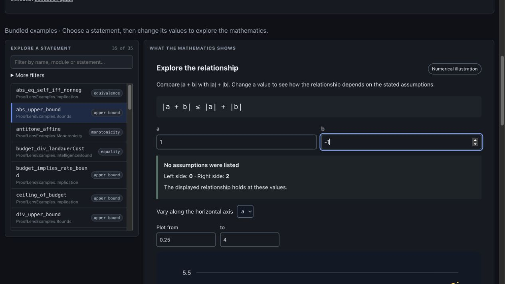

# See cancellation without losing the formal claim

A ProofLens showcase draft · prepared October 11, 2026 · source pinned to [`6d18d52fa3a780989e34ec75c38fa6e0ab26a154`](https://github.com/jdhart81/prooflens/commit/6d18d52fa3a780989e34ec75c38fa6e0ab26a154)

## The question

If two inputs cancel, why does the triangle inequality still hold? Reading `|a + b| ≤ |a| + |b|` gives the exact statement. Changing a concrete example makes the relationship easier to inspect.

## Try it in the browser

Open [ProofLens](https://jdhart81.github.io/prooflens/). No installation or account is required to explore the example. Estimated time: two minutes.

1. Under **Explore a statement**, select `abs_upper_bound`; filter by name if needed.
2. Set **a = 1** and **b = 1**. The live app shows left side **2**, right side **2**.
3. Change **b to −1**. The left side becomes **0**, while the right side stays **2**.
4. Connect the result to the original Lean statement and **Why this picture**. Optionally use **Save explanation** and **Save chart** to retain the app's labels and qualifications.

At the second input, cancellation reduces the magnitude of the sum. Adding the individual magnitudes still gives 2. The inequality holds at both displayed inputs.

The companion [interactive showcase](index.html) reproduces these numerical examples locally. Its browser arithmetic and SVG illustration are independent of the ProofLens pipeline. The actual app is the authoritative reproduction target.

## Follow the evidence

The pinned [Lean source](https://github.com/jdhart81/prooflens/blob/6d18d52fa3a780989e34ec75c38fa6e0ab26a154/corpus/ProofLensExamples/Bounds.lean#L86) contains:

```lean
theorem abs_upper_bound (a b : ℝ) : |a + b| ≤ |a| + |b| :=
  abs_add_le a b
```

The live bundled extraction records a Lean-checked declaration. The app's plot is still a numerical illustration. Its author-supplied reading of the variables as signal amplitudes is an interpretation; Lean does not validate a physical experiment.

The live controls and values above were checked October 11. Current-head GitHub evidence has seven successful check runs, including Lean corpus/end-to-end and Pages deployment; the non-gating mathlib coverage metric was skipped. See [source checks](https://github.com/jdhart81/prooflens/actions/runs/37862210751), [Pages deployment](https://github.com/jdhart81/prooflens/actions/runs/37862210705), and the [status-label model](https://github.com/jdhart81/prooflens/blob/6d18d52fa3a780989e34ec75c38fa6e0ab26a154/docs/epistemic-model.md).



## What this demonstrates

- A reader can inspect the mathematical statement, change supported inputs, and compare both sides.
- The explanation keeps formal proof status, numerical sampling and symbol interpretations visible as separate evidence.
- The source and reproduction steps are available for inspection.

It does not measure improved comprehension, prove arbitrary pasted statements, establish independent use or repeat use, or demonstrate revenue. Pasted source previews do not run Lean; admitted declarations remain unproved. Unsupported syntax is an explicit limit.

## What we want to learn next

Can an independent reader use ProofLens to answer a question they actually have, describe what became clearer, and later return for a different question? The [first-use packet](../first-use/PARTICIPANT_PACKET.md) and operator protocol carry that existing experiment forward. No independent outcome has been manufactured from this maintainer check.

Optional feedback goes through the existing [first-use report form](https://github.com/jdhart81/prooflens/issues/new?template=builder_trial.yml). It is public and requires a GitHub account to submit; use public or synthetic inputs and omit private research, credentials and personal information. Ask separately before quoting someone publicly.

## Reusable caption

> ProofLens numerical illustration: `a = 1, b = 1` gives `2 ≤ 2`; changing `b` to `−1` gives `0 ≤ 2`. The bundled declaration has Lean proof metadata; the sampled chart is an explanation, not a proof. Try the example: https://jdhart81.github.io/prooflens/

ProofLens is maintained by Justin Hart / Viridis and released under Apache-2.0. Contributions and their authors remain credited in the repository history. No third-party testimonial or endorsement is included in this showcase.
